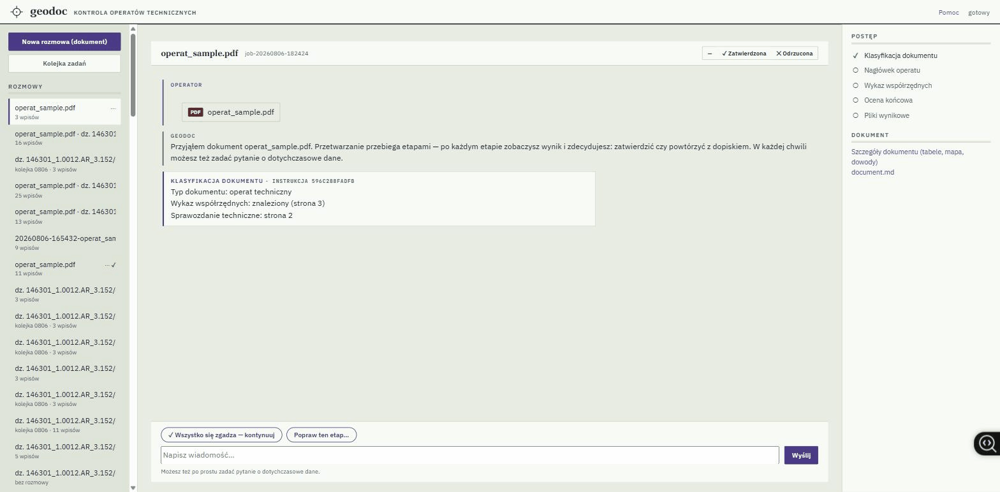
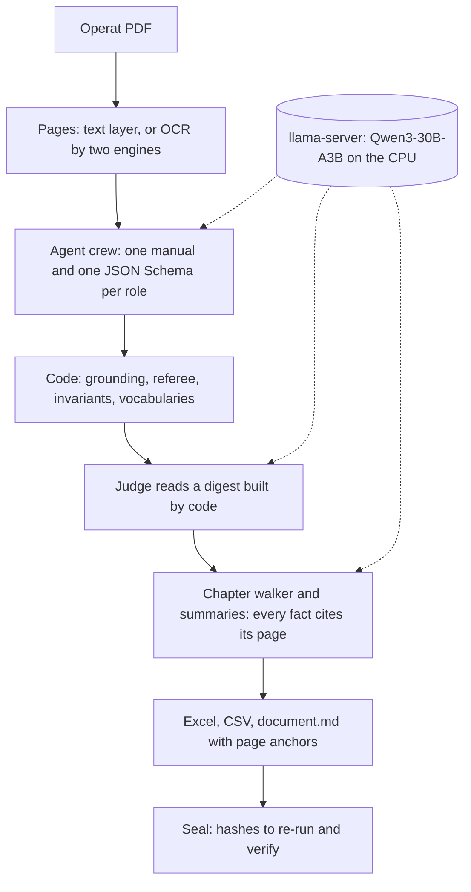

# geodoc

**Polish land-surveying reports (PDF) in; checked coordinate tables in Excel and CSV and a chapter map with page-grounded summaries out. It all runs on one ordinary 64 GB office machine, with no GPU and no cloud.**

[See it working](https://check-it-out-dev.github.io/geodoc/): a 16-second film of one report going through, with one correction typed in plain language. Code, tests and measurements are all in this repository.



The interface is in Polish, the language of its users. An **operat** (*operat techniczny*) is the report a licensed surveyor files after fieldwork: a cover sheet, a technical description, the list of boundary-point coordinates, maps and sketches. **PODGiK** is the county office that receives, checks and archives them. County offices receive [about 1.1 million notifications of surveying work a year](https://www.geoportal.gov.pl/aktualnosci/wyniki-badania-asortymentu-zglaszanych-prac-geodezyjnych/), and each one is documented in an operat.

## Why local

An operat carries personal data copied from the state land register: owners, parcels, addresses. A surveyor who receives that data is responsible for it under GDPR, and sending scans to a hosted model would add a processor, a contract and a transfer question for every document. geodoc does not raise those questions. The model, the OCR and every file stay on the office machine. The server listens only on `127.0.0.1` and accepts only loopback Host and Origin headers, and the installed app adds a per-session token.

## How it works

One open model, Qwen3-30B-A3B as a 4-bit GGUF, runs in llama.cpp's `llama-server` on the CPU and plays every role. Each role is a fresh call with its own Markdown manual ([`prompts/golden/`](prompts/golden/)) and a JSON Schema ([`schemas/`](schemas/)) that the server compiles into a grammar, so an answer outside the contract cannot be generated. Ten roles are wired: classifier, header extractor, coordinate-list extractor, judge, chapter walker, summariser, image describer, reviewer of finished jobs, conversation compactor, and a reflection role that proposes changes to the manuals. An eleventh manual, for reading PODGiK inspection protocols, is written but not wired yet.

The model never has the last word:

- Every extracted value must exist in the document. A value found on a different page than the one claimed is flagged for review, and so is a match that only works with diacritics folded.
- A regex parser re-reads the coordinate table as a referee.
- Two OCR engines must agree on a scanned coordinate before it counts as confirmed.
- Code computes the invariants: the area by the shoelace formula against the declared area, the point count, the coordinate-zone ranges, duplicate identifiers with contradictory coordinates, and the legal attribute vocabularies valid on the document's date.
- The judge reads a digest built by code, not the extractors' reasoning.
- Every summarised fact must cite a page, and its numbers must appear on that page.

Two gates from the original design are not in the code, for different reasons:

- **Self-consistency voting (G6)** would ask the model two or three times and keep the majority answer. It was rejected. The literature reports a gain of about 0.23 % on digits, which is not worth breaking the deterministic, temperature-0 transcription. The verdict is in the [decision ledger](docs/IDEAS.md).
- **Log-probability escalation (G7)** would flag a number the model generated with low confidence. It was accepted but never built. In practice the gates above cover it without trusting the model's confidence at all: a number must exist in the document, the regex referee must read the same coordinate, and on a scan two OCR engines must agree.

Each finished job gets a seal, `checks/pieczec.json`. It records the engine build, the model file sizes, the prompt hashes recorded by the classifier, the header extractor and the judge, the seed, and the sha256 of every text artifact of the job, the judge's verdict and the chapter map included; only the run log and the questions asked after the run stay outside. A later edit of any of those files no longer matches the seal. Whether a fresh model run reproduces the same bytes has not been measured. The weights are never trained: the system adapts through the manuals, the operator's notes and the conversation history.



The full design is in [docs/ARCHITECTURE.md](docs/ARCHITECTURE.md): the laws, the gate table and the harness. Every technique that was tried is recorded with its verdict in [docs/IDEAS.md](docs/IDEAS.md).

## Run it

You need Windows 10 or 11 (x64), Python 3.12 and about 20 GB of free disk.

```
git clone https://github.com/Check-It-Out-Dev/geodoc && cd geodoc
pip install -r requirements.txt
python tools/fetch_runtime.py      # llama.cpp b10155 + the 18.6 GB model, both sha256-checked
python tests/test_core.py          # the check suite; needs no model
python app/server.py               # open http://127.0.0.1:7420 and drop testdata/operat_sample.pdf in
```

If you already have the model file, `python tools/fetch_runtime.py --gguf-from <path>` links it instead of downloading it. If your files live elsewhere, a `models.local.json` overrides [`models.json`](models.json) on your machine.

The command line runs the whole pipeline on one file:

```
python app/agents.py testdata/operat_sample.pdf --verdict    # results in jobs/<job>/
```

`tools/build_installer.ps1` builds the Windows installer with Inno Setup 6. The installer bundles the model, a tray icon and an embedded Python; [docs/INSTALLER.md](docs/INSTALLER.md) documents it.

## How it was measured

| What | Result | Where to check |
|---|---|---|
| Check suite | 195 checks, about 10 seconds, no model needed; CI runs it on every push to main and on pull requests | `python tests/test_core.py` |
| Adversarial documents | 19 synthetic documents built to break it, each with its expected behaviour | [testdata/ARSENAL.md](testdata/ARSENAL.md) |
| Time | about 2 minutes per document plus about 4 seconds per page, on a 16-core desktop CPU | [docs/MEASUREMENTS.md](docs/MEASUREMENTS.md) |
| Accuracy | boundary points exact to the centimetre on the clean and scanned synthetic reports; on the heavily degraded scan OCR loses digits and the checks flag them | [docs/MEASUREMENTS.md](docs/MEASUREMENTS.md) |

The adversaries include a table of contents that lies, a foreign invoice bound into a chapter, two pages scanned onto one sheet, a 122-page report and a scan degraded with stains, skew and photocopy noise. The suite checks the two counts in this table against the harness and the arsenal file, so they cannot drift.

Accuracy exists only where gold exists. The gold documents are synthetic and seeded, and no real report has a gold answer, so no accuracy figure is claimed for real reports.

## Limits

- The conversation in the interface runs four stages (classification, header, coordinate list, verdict), with a person approving each one. The chapter map, the summaries and the seal come from the batch queue (*Kolejka zadań*) and from the command line.
- The seal hashes the job's artifacts, not the input PDF.
- Two designed gates are not in the code: one was rejected, one is covered by other gates (see How it works).
- Starting the model engine reads the machine's memory through a Windows API, and the launcher is a `.pyw` file, so Windows is the only tested platform.

## Licence

geodoc is released under the [MIT licence](LICENSE).

Everything it depends on is under a permissive licence:

- The model, Qwen3 (Apache 2.0), and llama.cpp (MIT) are downloaded by `fetch_runtime.py`, not stored here.
- pypdfium2 and PDFium (BSD-3 / Apache 2.0), RapidOCR and OnnxTR (Apache 2.0), ONNX Runtime (MIT), openpyxl (MIT) and Pillow (MIT-CMU) are installed by `pip`.
- The three fonts (SIL OFL 1.1) are in [`app/czcionki/`](app/czcionki/) with their licence texts.
- PyMuPDF (AGPL-3.0) is used only by the developer tools that generate the synthetic test PDFs, and never by the product.

The full list with notices is in [docs/THIRD-PARTY-LICENSES.md](docs/THIRD-PARTY-LICENSES.md).

## Documentation

The full engineering record is in [`docs/`](docs/):

- [ARCHITECTURE.md](docs/ARCHITECTURE.md): the design, its laws, the gate table and the harness.
- [IDEAS.md](docs/IDEAS.md): every technique that was tried, with its verdict and the reason, wave by wave.
- [SOTA-2026-08.md](docs/SOTA-2026-08.md): the research dossier behind the engine settings and the gates, with sources.
- [MEASUREMENTS.md](docs/MEASUREMENTS.md): what was measured, on what, and what was not.
- [INSTALLER.md](docs/INSTALLER.md) and [PACKAGING.md](docs/PACKAGING.md): the Windows installer and how it is built.
- [DESIGN-SYSTEM.md](docs/DESIGN-SYSTEM.md): the interface's visual rules.
- [PYTHON-ENGINEERING.md](docs/PYTHON-ENGINEERING.md): the code audit and what it changed.
- [THIRD-PARTY-LICENSES.md](docs/THIRD-PARTY-LICENSES.md): every third-party component and its notice.

The interface and the agents' manuals stay in Polish, because they speak to Polish users and read Polish documents.
